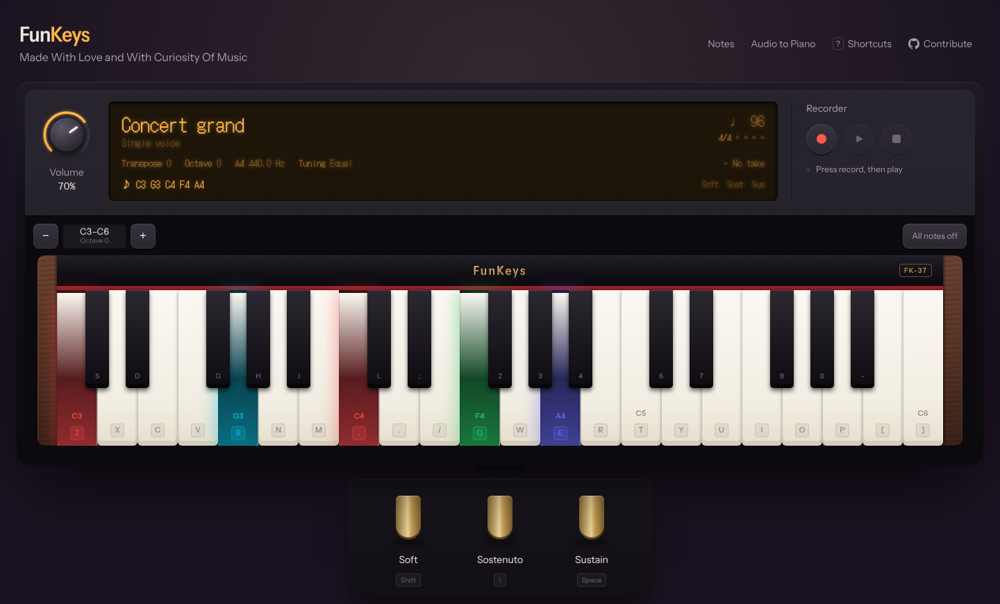
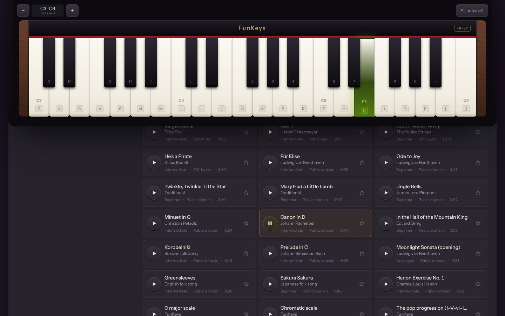
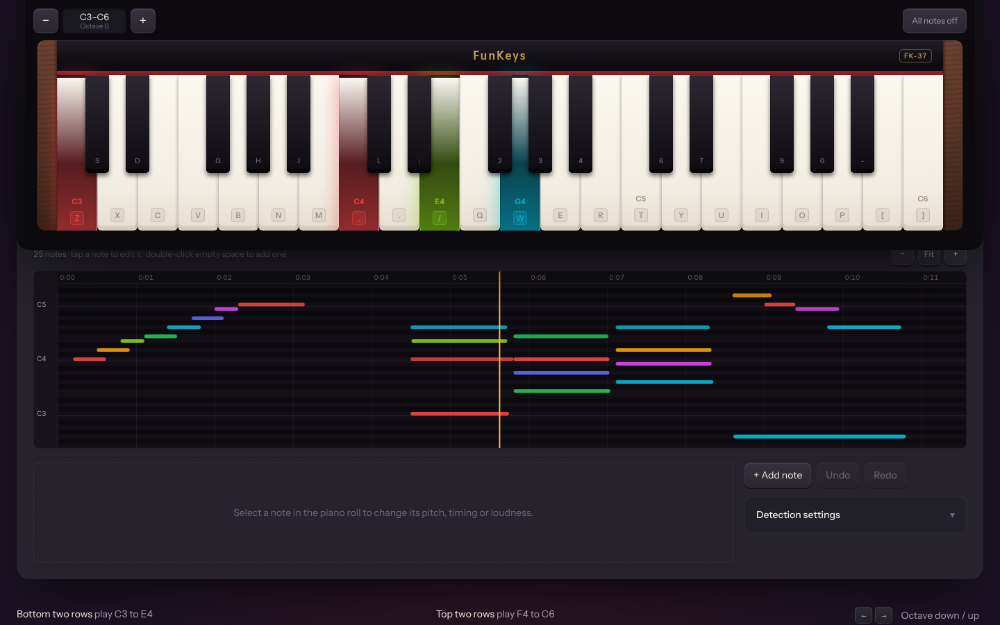

<div align="center">

# FunKeys

**A playable piano in your browser: computer keyboard, mouse or touch, synthesized live.**

Songs that play on the keys, and **Audio to Piano**: turn a piano recording into notes that FunKeys plays back.<br/>
No audio files, no server: every note is generated in real time with the Web Audio API.

**[▶ Play it live](https://fun-keys.vercel.app)**

[](https://github.com/satyaidk/funkeys/actions/workflows/ci.yml)


[Getting started](#getting-started) · [Features](#features) · [How to play](#how-to-play) · [Audio to Piano](#audio-to-piano) · [Architecture](#architecture) · [Documentation](#documentation)



</div>

---

## Overview

FunKeys turns all four letter and number rows of your keyboard into a piano shaped like the real thing: each pair of rows is a strip of white keys with black keys above, so the bottom rows play **C3–E4** and the top rows continue to **C6**. On a phone the keyboard docks to the bottom of the screen and plays chords and glissandos under your fingers.

It recreates the functions of real digital pianos (Yamaha Clavinova, Roland FP-30X), researched from their manuals: voices, layer and split, three pedals, touch sensitivity, reverb, transpose, master tuning and historical temperaments, a metronome and a recorder. On top of that:

- **Notes**: a library of 27 songs (classical pieces, riffs, exercises) that play on the keyboard, keys lighting up as they go
- **Audio to Piano**: Spotify's Basic Pitch model listens to a piano recording, in your browser, and writes out the notes; fix any it got wrong, play them on the FunKeys piano, export MIDI

The project is built the way production software is: a layered architecture, 448 unit and integration tests plus Playwright end-to-end tests in a real browser, CI on every push, and documentation including 15 Architecture Decision Records.

## Features

| Feature | Details |
| --- | --- |
| **37-key keyboard** | Two piano-shaped manuals on the computer keyboard; mouse, multi-touch chords and glissandos; octave buttons to reach C1–C8 |
| **Phones and tablets** | The keyboard docks to the bottom of a phone screen (pinned to the top on tall screens), keys stay a playable 40 px wide, and a minimap moves along the keyboard |
| **8 voices** | Concert grand, Bright grand, Electric piano, Harpsichord, Drawbar organ, String ensemble, Vibraphone, Celesta |
| **Layer & split** | Two voices on every key with a balance knob, or a separate left-hand voice with a movable split point |
| **Three pedals** | Soft (una corda), sostenuto and sustain, with the real-piano rules |
| **Touch, reverb, tuning** | Touch curves; room, hall or cathedral reverb; brilliance; transpose ±12; A4 = 415.3–466.2 Hz; six temperaments |
| **Metronome & recorder** | 30–240 BPM with tap tempo; record a take and play it back through the instrument |
| **Notes library** | 27 songs: public-domain classics (Für Elise and Moonlight with both hands, Canon in D, Bach's Prelude in C…), riffs by ear, practice exercises. Search, categories, levels, favorites, curated picks; play, pause, seek, 50–125% speed, loop |
| **Audio to Piano** | Piano recording (WAV, MP3, …) → notes, with polyphony and timing kept; piano-roll editor with undo; plays across the recording's full length; MIDI and FunKeys notes export; MIDI import |
| **Visual feedback** | Every note has its own color; sustained notes glow; the LCD shows what's sounding |
| **Accessible** | Screen-reader labels, keyboard-operable controls (radio groups, tabs, sliders, the piano roll), reduced-motion support |

### Sound engine

Every voice is synthesized from a data-driven recipe: additive synthesis with string inharmonicity, FM for the electric piano, vibrato and tremolo, hammer and pluck noise, natural decay, velocity-dependent brightness, convolution reverb, 64-voice polyphony. Songs and transcriptions are **booked on the audio clock**, so timing is sample-accurate however long they run.

<div align="center">

</div>

## Getting started

**Prerequisites:** [Node.js](https://nodejs.org) 22.12 or newer.

```bash
git clone https://github.com/satyaidk/funkeys.git
cd funkeys
npm install
npm run dev
```

Open **http://localhost:3000** and press a key. Browsers allow sound only after you interact with the page, so audio starts on your first key press, click or tap.

## How to play

### Computer keyboard

```
 Upper manual: F4 → C6
   2   3   4       6   7       9   0   -         black keys
 Q   W   E   R   T   Y   U   I   O   P   [   ]   white keys

 Lower manual: C3 → E4
   S   D       G   H   J       L   ;             black keys
 Z   X   C   V   B   N   M   ,   .   /           white keys
```

| Keys | Action |
| --- | --- |
| `←` `→` | Octave down / up |
| `↑` `↓` | Transpose down / up a semitone |
| `Space` (hold) | Sustain pedal |
| `Shift` (hold) | Soft pedal |
| `\` (hold) | Sostenuto pedal |

Keys are matched by position, so the layout works on AZERTY and QWERTZ keyboards too, and notes never play while you type in a text field. The **Shortcuts** button in the header lists everything.

### Touch and mouse

Tap a key (nearer the front edge plays louder), put several fingers down for a chord, slide along the keys for a glissando. **− / +** move the keyboard an octave; on a phone, drag the strip above the keys (or use ‹ ›) to see other parts of it.

## Audio to Piano

<div align="center">

</div>

1. Open **Audio to Piano** and choose (or drop) a piano recording: WAV, MP3, and OGG, FLAC, M4A or WebM where your browser can decode them; up to 10 minutes and 100 MB
2. [Basic Pitch](https://github.com/spotify/basic-pitch-ts), Spotify's open-source transcription model, listens in a background worker, on your graphics card where available. **Nothing is uploaded or stored**
3. The notes appear in a piano roll: chords, overlapping notes, rests and the recording's full length are kept. Fix anything it got wrong (pitch, start, length, velocity, delete, add), with undo
4. Press Play: **the FunKeys piano** plays the notes (never the original audio), keys lighting up, with seek, speed and loop. Export **MIDI** or **FunKeys notes**

Transcription is an estimate. On a synthesized test recording with known notes it found **25 of 25 notes with no false ones, onsets within 5 ms on average**; a real piano recording will be harder. Without a GPU it runs about 2× slower than real time. Details and limits: [ADR 0014](docs/decisions/0014-transcribe-audio-in-the-browser.md).

## Architecture

```
UI components  ──►  React hooks  ──►  core library (plain TypeScript)  ──►  Web Audio API · Web Worker
src/components      src/hooks         src/lib/music · audio · transcription
```

Each layer depends only on the layers below it, so the music, audio and transcription core is framework-free and directly testable. Highlights:

- **Audio-clock playback**: one lookahead scheduler (`SequencePlayer`) books notes ahead at exact audio times, with play, pause, seek, speed and loop ([ADR 0013](docs/decisions/0013-play-sequences-on-the-audio-clock.md))
- **In-browser transcription**: Basic Pitch in a Web Worker, chunked note decoding, validation on both sides of the worker boundary ([ADR 0014](docs/decisions/0014-transcribe-audio-in-the-browser.md))
- **Multi-touch input**: one pointer handler with pointer capture and a pure `PointerTracker`, so fingers chord and glide ([ADR 0015](docs/decisions/0015-docked-keyboard-on-phones.md))
- **Pure state machines** for the pedals (`NoteTracker`), fingers (`PointerTracker`) and the note editor (a reducer with undo)
- **Data-driven** voices and songs: adding an instrument or a song means adding an object
- **A hardware-style design system** of accessible primitives

Read the full [architecture guide](docs/architecture.md).

## Tech stack

| Area | Technology |
| --- | --- |
| Framework | [Next.js 16](https://nextjs.org) (App Router, static pre-rendering, Turbopack) |
| UI | [React 19](https://react.dev), [Tailwind CSS 4](https://tailwindcss.com), [Framer Motion](https://motion.dev) |
| Language | [TypeScript](https://www.typescriptlang.org) (strict) |
| Audio | [Web Audio API](https://developer.mozilla.org/docs/Web/API/Web_Audio_API) |
| Transcription | [Basic Pitch](https://github.com/spotify/basic-pitch-ts) on [TensorFlow.js](https://www.tensorflow.org/js) 3, in a Web Worker |
| Testing | [Vitest](https://vitest.dev), [React Testing Library](https://testing-library.com), a fake Web Audio API, [Playwright](https://playwright.dev) |
| CI | GitHub Actions: lint, type-check, unit tests, build, end-to-end tests |

## Project structure

```
src/
├── app/                    # Next.js route, layout, design tokens (dock/pin variants), icon
├── components/
│   ├── PianoApp.tsx        # Client root: wires the hooks, lays out the page
│   ├── layout/             # Header, motion settings
│   ├── console/            # LCD, recorder, function tabs and pages (Voice … Notes)
│   ├── piano/              # Keyboard, keys, octave controls, minimap, pedals
│   ├── playback/           # Transport bar, mini piano roll
│   ├── transcription/      # Audio to Piano page, piano-roll editor, note inspector
│   └── ui/                 # Design-system primitives
├── hooks/                  # usePiano, useSequencePlayer, useTranscription, useMetronome, …
├── lib/
│   ├── music/              # Notes, keyboard map, tuning, melody format, songs, MIDI files
│   ├── audio/              # Engine, voice synthesis, effects, metronome, sequence player
│   ├── transcription/      # File checks, decoding, Basic Pitch worker, note decoding, editor
│   └── *.ts                # Pedal and pointer state machines, voicing, settings
├── test/                   # Test setup and fake Web Audio API
└── types/                  # Shared domain types
e2e/                        # Playwright tests and the transcription fixture
public/models/basic-pitch/  # The transcription model (Apache-2.0)
scripts/                    # Model sync, fixture generator
docs/                       # Architecture, concepts, code walkthrough, ADRs, guides
```

## Scripts

| Command | Description |
| --- | --- |
| `npm run dev` | Start the development server |
| `npm run build` | Create a production build |
| `npm start` | Serve the production build |
| `npm run lint` | Run ESLint |
| `npm run typecheck` | Type-check with TypeScript |
| `npm test` | Run the unit and integration tests once |
| `npm run test:watch` | Run them in watch mode |
| `npm run test:e2e` | Run the Playwright tests (after `npm run build`; first time: `npx playwright install chromium`) |
| `npm run validate` | Lint, type-check, test and build |
| `npm run sync:model` | Copy the Basic Pitch model from `node_modules` into `public/` (after upgrading it) |
| `npm run fixture:piano` | Regenerate the transcription test recording |

## Testing

**448 unit and integration tests** (Vitest, about 15 s) cover the music math, synthesis graph, pedal and pointer rules, audio-clock scheduling (with a fake clock, up to a five-minute timeline), song data, MIDI round trips, transcription decoding and the UI. **Playwright** runs the real app in Chromium on a desktop and a phone-sized touch screen: chords and glissandos under real touch events, no sideways scrolling at eight widths from 320 to 1440 px, songs lighting keys, and a full transcription scored against the notes that were played.

```bash
npm test
npm run build && npm run test:e2e
```

See the [testing guide](docs/testing.md).

## Documentation

The [`docs/`](docs/README.md) folder explains the project from the big picture down to every file:

| Guide | What's inside |
| --- | --- |
| [Digital piano functions](docs/concepts/piano-functions.md) | What each feature does on a real piano, with sources |
| [Architecture](docs/architecture.md) | Layers, data flow, state, audio graph, playback, transcription |
| [Music theory](docs/concepts/music-theory.md) · [Web Audio](docs/concepts/web-audio.md) · [React patterns](docs/concepts/react-patterns.md) | The concepts behind the code |
| [Code walkthrough](docs/code-walkthrough/) | Every file explained, in eight parts |
| [Decision records](docs/decisions/) | 15 ADRs: why key choices were made |
| [Testing](docs/testing.md) · [Development](docs/development.md) · [Roadmap](docs/roadmap.md) | Working on the project |

## Roadmap

Saved settings, MIDI keyboard input, chord detection on the LCD, a sampled grand piano, a faster CPU path for transcription (WebAssembly), and transcription chasing notes held across a seek. See the [roadmap](docs/roadmap.md).

## Contributing

1. Create a branch from `dev` (`feat/…`, `fix/…`)
2. Make your change with tests; update the docs
3. Run `npm run validate` (and `npm run test:e2e` for UI changes)
4. Open a pull request into `dev` using [Conventional Commits](https://www.conventionalcommits.org)

Details in the [development guide](docs/development.md).

## Acknowledgements

- [Basic Pitch](https://github.com/spotify/basic-pitch-ts) by Spotify's Audio Intelligence Lab (Apache-2.0): the transcription model, served from `public/models/basic-pitch` with its license
- Chris Wilson, [*A Tale of Two Clocks*](https://web.dev/articles/audio-scheduling): the scheduling technique behind the metronome and playback
- Yamaha and Roland owner's manuals: the functions and value ranges of real digital pianos
- Historical temperament tables from [Wikipedia](https://en.wikipedia.org/wiki/Werckmeister_temperament) and standard just-intonation ratios

Songs in the Notes library are public-domain works, original exercises, or short riffs simplified by ear and labelled as such. See the [changelog](CHANGELOG.md) for release history.
